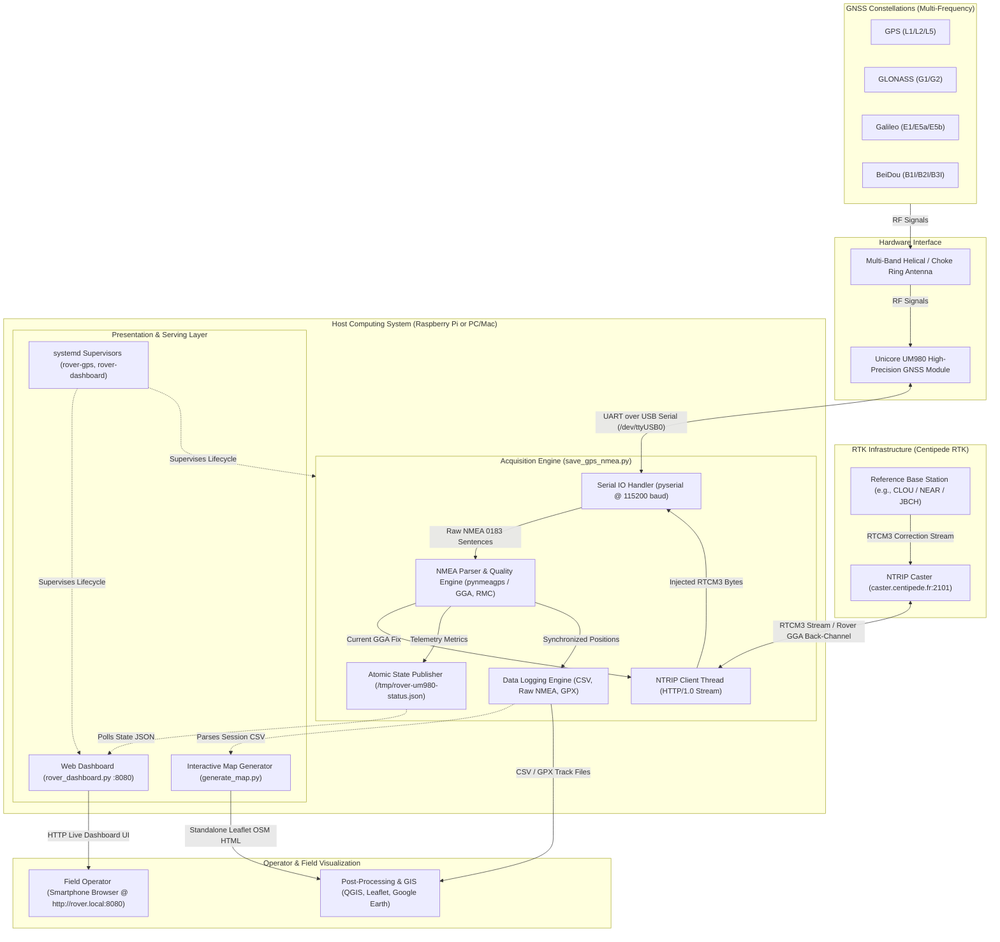

# Rover RTK GNSS

> **Centimeter-Accurate Multi-Band GNSS Acquisition & Real-Time RTK Corrections for Unicore UM980 Receivers**

[](LICENSE)
[](https://www.python.org/)
[-brightgreen.svg)](#data-formats--precision-reference)
[](#project-overview)
[](https://centipede.fr)
[](#project-overview)
[](#repository-structure)

---

## Table of Contents

- [Project Overview](#project-overview)
- [Architecture / Workflow Diagram](#architecture--workflow-diagram)
- [Key Features](#key-features)
- [Visuals & Illustrations](#visuals--illustrations)
- [Repository Structure](#repository-structure)
- [Repository Usage & Getting Started](#repository-usage--getting-started)
  - [Prerequisites](#prerequisites)
  - [Installation](#installation)
  - [Hardware Detection & Initial Verification](#hardware-detection--initial-verification)
- [Usage Examples](#usage-examples)
  - [1. Real-Time Acquisition with Automatic NTRIP RTK](#1-real-time-acquisition-with-automatic-ntrip-rtk)
  - [2. Targeting a Specific RTK Base Station](#2-targeting-a-specific-rtk-base-station)
  - [3. Discovering Nearby Centipede Base Stations](#3-discovering-nearby-centipede-base-stations)
  - [4. Autonomous Acquisition (Offline / SPS Mode)](#4-autonomous-acquisition-offline--sps-mode)
  - [5. Timed Session with GPX Export](#5-timed-session-with-gpx-export)
  - [6. Real-Time Web Dashboard (Mobile Field Monitoring)](#6-real-time-web-dashboard-mobile-field-monitoring)
  - [7. Headless Autonomous Deployment with systemd](#7-headless-autonomous-deployment-with-systemd)
  - [8. Interactive Map Generation](#8-interactive-map-generation)
- [API Reference / Configuration](#api-reference--configuration)
  - [Configuration File (`ntrip.conf`)](#configuration-file-ntripconf)
  - [CLI Reference: `save_gps_nmea.py`](#cli-reference-save_gps_nmeapy)
  - [CLI Reference: `rover_dashboard.py`](#cli-reference-rover_dashboardpy)
  - [CLI Reference: `generate_map.py`](#cli-reference-generate_mappy)
  - [Telemetry JSON Schema (`/tmp/rover-um980-status.json`)](#telemetry-json-schema-tmprover-um980-statusjson)
- [Data Formats & Precision Reference](#data-formats--precision-reference)
  - [CSV Recording Structure](#csv-recording-structure)
  - [GNSS & RTK Precision Fix Levels](#gnss--rtk-precision-fix-levels)
- [Contributing & License](#contributing--license)

---

## Project Overview

Standard standalone GNSS (GPS) receivers typically achieve an absolute accuracy of **1.5 to 5 meters**. While sufficient for basic vehicular navigation, this margin of error is unusable for precision agriculture, geodetic surveying, autonomous robotics, mobile mapping, or limnological and environmental transects.

**Rover RTK GNSS** delivers a production-grade, pure-Python acquisition and differential correction pipeline built specifically for the high-performance **Unicore UM980** multi-band GNSS receiver (supporting GPS L1/L2/L5, GLONASS L1/L2, Galileo E1/E5a/E5b, BeiDou B1I/B2I/B3I, and QZSS).

By integrating a lightweight NTRIP client connecting to open differential networks such as [Centipede RTK](https://centipede.fr), the system injects real-time **RTCM3** correction streams directly back into the UM980 over serial USB, consistently reaching **1 to 2 cm RTK Fixed** spatial precision.

> [!IMPORTANT]
> **No pygpsclient or heavy GUI stacks required.** This codebase provides a zero-bloat, direct-to-serial architecture designed for maximum reliability in the field, headless battery-powered operation, and seamless post-processing workflows.

The repository accommodates two distinct operating workflows:
1. **Autonomous Embedded Rover (`rover-um980/`)**: Designed for headless Raspberry Pi field deployments. It automatically joins a smartphone Wi-Fi hotspot upon power-up, starts background acquisition and NTRIP injection via `systemd`, serves a touch-friendly live Web Dashboard at `http://rover.local:8080`, and writes clean CSV, raw NMEA, and GPX logs.
2. **Workstation & Laptop Direct (`um980-pc/`)**: Tailored for direct USB connection to a field laptop or lab workstation under Linux or macOS for manual recording, rapid diagnostics, and ad-hoc surveying.

---

## Architecture / Workflow Diagram

The diagram below illustrates the end-to-end data flow—from satellite signals and differential correction casters down to hardware ingestion, background services, and field operator visualization:



---

## Key Features

| Feature | Technical Benefit | Typical Use Case |
|---|---|---|
| **Centimeter RTK Precision** | Resolves positions down to **1–2 cm** (RTK Fixed) and **10–30 cm** (RTK Float). | High-precision field surveying, drone control, and environmental ground truthing. |
| **Multi-Constellation Multi-Band** | Tracks GPS, GLONASS, Galileo, BeiDou, and QZSS across multiple frequencies simultaneously. | Rapid carrier-phase integer ambiguity resolution under challenging tree cover or topography. |
| **Integrated NTRIP Client** | Direct RTCM3 stream injection back to receiver RX; periodic GGA feedback for VRS support. | Seamless integration with free public networks (Centipede RTK) or private RTK bases. |
| **Nearest Base Auto-Selection** | Automatic nearest station routing (`NEAR` mountpoint) or explicit station locking (`CLOU`, `JBCH`, etc.). | Moving rover transects across regional borders or fixed high-repeatability benchmarks. |
| **Zero Heavy Dependencies** | Pure Python implementation relying solely on `pyserial` and `pynmeagps` without GUI baggage. | Headless, ultra-low resource footprint on Raspberry Pi Zero / 3 / 4 / 5 or barebones servers. |
| **Real-Time Mobile Web Dashboard** | Touch-optimized dark-mode dashboard showing fix status, satellites, HDOP, disk, and live map links. | Headless smartphone monitoring in the field over Wi-Fi without cables or external monitors. |
| **Autonomous `systemd` Services** | Auto-start on boot, auto-reconnect on USB or network dropout, atomic JSON status publishing. | Unattended battery-powered field rovers operating entirely hands-free. |
| **Tri-Format Synchronous Logging** | Simultaneously records structured CSV, raw immutable NMEA 0183 `.nmea`, and GIS-ready `.gpx`. | Complete archival integrity: post-processing in QGIS while preserving raw sensor telemetry. |
| **Interactive Map Visualizer** | Generates standalone Leaflet/OpenStreetMap HTML files color-coded by RTK fix quality. | Immediate visual session validation and quality reporting right after field campaigns. |

---

## Visuals & Illustrations

> [!TIP]
> The screenshots below showcase the field dashboard interface and interactive trajectory visualizer.

```
+-----------------------------------------------------------------------------------+
|                               FIELD DASHBOARD PREVIEW                             |
|                                                                                   |
|  [ Live Fix: RTK FIXED (1-2 cm) ]     [ Sats: 22 ]     [ HDOP: 0.8 ]    [ 404.0 m ] |
|  Lat: 45.123456789 N   Lon: 5.123456789 E   Speed: 0.6 km/h   Diff Age: 1.0s      |
|  Mountpoint: CLOU (12.0 km)   File: gps_nmea_20260914_000204.csv (14.2 MB)        |
+-----------------------------------------------------------------------------------+
```


*Figure 1: Lightweight mobile web dashboard displaying real-time RTK status, satellite telemetry, and quick-access map links.*


*Figure 2: Trajectory rendered via `generate_map.py`, color-coded by GNSS fix quality (Green: RTK Fixed, Yellow: RTK Float, Blue: DGPS).*

---

## Repository Structure

```text
rover-RTK-gnss/
├── .gitignore                      # Shared git ignore (logs, venv, caches, session data)
├── README.md                       # Comprehensive project documentation
├── rover-um980/                    # Autonomous Raspberry Pi deployment package
│   ├── config/                     # Device configuration templates
│   ├── systemd/                    # systemd service units for automated boot execution
│   │   ├── rover-dashboard.service # Background HTTP dashboard service (:8080)
│   │   └── rover-gps.service       # Background GNSS acquisition & NTRIP client service
│   ├── generate_map.py             # Interactive Leaflet/OSM HTML map generation script
│   ├── ntrip.conf                  # NTRIP caster & station credentials configuration
│   ├── PLAN.md                     # Step-by-step deployment guide for headless Raspberry Pi
│   ├── README.md                   # Dedicated documentation for the rover unit
│   ├── requirements.txt            # Python dependencies (pyserial, pynmeagps)
│   ├── rover_dashboard.py          # Standalone HTTP mobile web dashboard
│   └── save_gps_nmea.py            # Primary GNSS acquisition engine & NTRIP client
└── um980-pc/                       # Workstation & laptop deployment package
    ├── ntrip.conf                  # NTRIP caster configuration
    ├── README.md                   # Dedicated documentation for PC/workstation use
    ├── requirements.txt            # Python dependencies
    └── save_gps_nmea.py            # Primary GNSS acquisition engine & NTRIP client
```

---

## Repository Usage & Getting Started

### Prerequisites

- **Hardware**:
  - Unicore UM980 GNSS receiver module (connected via USB-UART bridge, default 115200 baud).
  - Multi-band GNSS antenna (supporting L1/L2/L5, active, placed with an unobstructed view of the sky).
  - Host computer: Raspberry Pi (Raspberry Pi OS Bookworm or later) or PC/Mac (Linux, macOS).
  - Active Internet connection for NTRIP corrections (Wi-Fi, 4G/5G mobile hotspot, or Ethernet).
- **Software**:
  - Python 3.9 or higher.
  - Standard `pip` and `venv` tooling.

### Installation

1. **Clone the repository**:
   ```bash
   git clone https://github.com/vtk-carrtel/rover-RTK-gnss.git
   cd rover-RTK-gnss
   ```

2. **Select your target module**:
   - For an autonomous Raspberry Pi field unit:
     ```bash
     cd rover-um980
     ```
   - For a workstation or field laptop:
     ```bash
     cd um980-pc
     ```

3. **Set up a Python virtual environment**:
   ```bash
   python3 -m venv .venv
   source .venv/bin/activate
   pip install --upgrade pip
   pip install -r requirements.txt
   ```

> [!NOTE]
> `save_gps_nmea.py` includes an automatic re-execution wrapper: if a local `.venv` exists in the script directory, it automatically re-executes itself using `.venv/bin/python3` even if invoked with the system Python interpreter.

### Hardware Detection & Initial Verification

Verify that your host operating system recognizes the UM980 USB serial bridge:

```bash
./save_gps_nmea.py --list-ports
```

*Expected output:*
```text
Available serial ports:
  /dev/ttyUSB0 - FT230X Basic UART - FTDI (USB VID:PID=0403:6015)
```

Test querying the nearest Centipede RTK reference stations to verify Internet connectivity:

```bash
./save_gps_nmea.py --ntrip-list
```

---

## Usage Examples

### 1. Real-Time Acquisition with Automatic NTRIP RTK

The recommended default mode connects to the Unicore UM980, auto-detects the serial port, connects to the Centipede RTK caster, requests the `NEAR` auto-mountpoint (VRS / closest physical base), and logs CSV + raw NMEA data:

```bash
./save_gps_nmea.py --ntrip
```

### 2. Targeting a Specific RTK Base Station

To fix corrections to a known geodetic reference monument (for example, station `CLOU` in Évian-les-Bains or `JBCH` in Annemasse):

```bash
# Connect to Évian-les-Bains base station
./save_gps_nmea.py --ntrip CLOU

# Connect to Annemasse base station
./save_gps_nmea.py --ntrip JBCH
```

### 3. Discovering Nearby Centipede Base Stations

Query the live Centipede RTK caster sourcetable, calculate distances relative to your local base location (default reference coordinates set in `save_gps_nmea.py`), and display closest candidates:

```bash
./save_gps_nmea.py --ntrip-list
```

### 4. Autonomous Acquisition (Offline / SPS Mode)

Record raw GNSS data without an active Internet connection or differential corrections:

```bash
./save_gps_nmea.py --no-ntrip
```

### 5. Timed Session with GPX Export

Record a 120-second transect, stop automatically, and export a synchronized `.gpx` track file alongside the CSV:

```bash
./save_gps_nmea.py --ntrip -d 120 --gpx -f survey_transect_01
```

Generated session files in `enregistrements/`:
- `survey_transect_01.csv` (Structured geodetic telemetry)
- `survey_transect_01.nmea` (Raw NMEA 0183 stream)
- `survey_transect_01.gpx` (Standard GPX track with elevations and timestamps)

### 6. Real-Time Web Dashboard (Mobile Field Monitoring)

Start the lightweight mobile web server to monitor rover status from a smartphone:

```bash
python3 rover_dashboard.py --host 0.0.0.0 --port 8080
```

From any mobile phone or tablet connected to the rover's Wi-Fi hotspot:
- Open your browser to: `http://rover.local:8080` (or the Raspberry Pi IP, e.g., `http://192.168.43.50:8080`).
- Monitor live fix type (`RTK FIXED`, `RTK FLOAT`, `DGPS`), number of satellites, HDOP, coordinates, recording elapsed time, file sizes, and available disk space.
- Tap **Ouvrir la carte** to inspect the current position directly in Google Maps.

### 7. Headless Autonomous Deployment with systemd

For fully unattended Raspberry Pi operation in the field:

```bash
# Link service unit files
sudo systemctl link "$PWD/systemd/rover-gps.service"
sudo systemctl link "$PWD/systemd/rover-dashboard.service"

# Enable and start immediately
sudo systemctl daemon-reload
sudo systemctl enable --now rover-gps.service rover-dashboard.service

# Check service execution status
systemctl status rover-gps.service rover-dashboard.service

# Follow live acquisition logs
journalctl -u rover-gps.service -f
```

### 8. Interactive Map Generation

Transform any recorded CSV session into an interactive, browser-based OpenStreetMap/Leaflet map:

```bash
# Process the latest recording in enregistrements/
python3 generate_map.py

# Or specify a particular recording session
python3 generate_map.py -i enregistrements/gps_nmea_20260914_000204.csv -o output_map.html
```

The output file displays:
- Interactive zoomable OpenStreetMap layer.
- Color-coded track points indicating GNSS fix quality.
- Point-by-point telemetry popup (timestamp, altitude, satellites, HDOP, speed, correction age).
- Summary metrics: total distance traveled, elapsed time, and RTK Fix percentage.

---

## API Reference / Configuration

### Configuration File (`ntrip.conf`)

Located in both `rover-um980/ntrip.conf` and `um980-pc/ntrip.conf`:

| Parameter | Type | Default | Description |
|---|---|---|---|
| `enabled` | `boolean` | `false` | Enable NTRIP RTK client automatically upon script launch without `--ntrip`. |
| `server` | `string` | `caster.centipede.fr` | Hostname or IP address of the NTRIP Caster. |
| `port` | `integer` | `2101` | TCP port of the NTRIP Caster. |
| `mountpoint` | `string` | `NEAR` | Mountpoint or stream identifier. Use `NEAR` for nearest base auto-allocation. |
| `user` | `string` | `centipede` | NTRIP authentication username (free on Centipede RTK). |
| `password` | `string` | `centipede` | NTRIP authentication password. |
| `gga_interval` | `float` | `10.0` | Interval (in seconds) between outgoing NMEA GGA positions sent to caster. |

### CLI Reference: `save_gps_nmea.py`

| Option | Type | Default | Description |
|---|---|---|---|
| `-p`, `--port` | `string` | `Auto-detect` | Serial device path (e.g., `/dev/ttyUSB0`, `/dev/ttyACM0`, `COM3`). |
| `-b`, `--baud` | `integer` | `115200` | Serial baud rate for the receiver interface. |
| `-o`, `--output-dir` | `string` | `enregistrements` | Destination directory for session recordings. |
| `--prefix` | `string` | `gps_nmea` | File name prefix for timestamped output files. |
| `-f`, `--output-name` | `string` | `None` | Explicit base file name (omits timestamp prefixing). |
| `-d`, `--duration` | `float` | `None` | Maximum recording duration in seconds before exiting. |
| `-n`, `--count` | `integer` | `None` | Maximum number of valid position fixes to capture before exiting. |
| `--ntrip [STATION]` | `string` | `NEAR` | Enable NTRIP RTK client. Optional positional argument specifies mountpoint. |
| `--no-ntrip` | `flag` | `false` | Force autonomous mode (disables NTRIP even if enabled in `ntrip.conf`). |
| `--ntrip-mountpoint` | `string` | `From conf` | Explicitly override the NTRIP stream mountpoint. |
| `--ntrip-server` | `string` | `From conf` | Override NTRIP Caster hostname. |
| `--ntrip-port` | `integer` | `From conf` | Override NTRIP Caster port. |
| `--ntrip-user` | `string` | `From conf` | Override NTRIP username. |
| `--ntrip-password` | `string` | `From conf` | Override NTRIP password. |
| `--ntrip-gga-interval` | `float` | `10.0` | Transmission rate (s) for GGA feedback to caster. |
| `--ntrip-list` | `flag` | `false` | Fetch sourcetable, print stations sorted by distance to local reference, and exit. |
| `--gpx` | `flag` | `false` | Export a standard GPX track file alongside CSV and raw NMEA. |
| `--raw-only` | `flag` | `false` | Capture raw NMEA stream only (disables CSV generation). |
| `--no-raw` | `flag` | `false` | Disable raw `.nmea` file generation (writes CSV only). |
| `--no-csv` | `flag` | `false` | Disable parsed `.csv` file generation. |
| `--status-file` | `string` | `/tmp/rover-um980-status.json` | Path to atomic JSON status file consumed by the dashboard. |
| `-v`, `--verbose` | `flag` | `false` | Echo every raw incoming NMEA sentence to stdout. |
| `-q`, `--quiet` | `flag` | `false` | Suppress ANSI terminal status line updates. |
| `--list-ports` | `flag` | `false` | Print detected serial hardware devices and exit. |
| `-h`, `--help` | `flag` | `—` | Display command-line help summary and exit. |

### CLI Reference: `rover_dashboard.py`

| Option | Type | Default | Description |
|---|---|---|---|
| `--host` | `string` | `0.0.0.0` | Network binding address for HTTP server. |
| `--port` | `integer` | `8080` | Network listening port for HTTP server. |
| `--status-file` | `string` | `/tmp/rover-um980-status.json` | Path to recorder state JSON file. |

### CLI Reference: `generate_map.py`

| Option | Type | Default | Description |
|---|---|---|---|
| `-i`, `--input` | `string` | `Latest CSV` | Path to input CSV recording file. Defaults to latest file in `enregistrements/`. |
| `-o`, `--output` | `string` | `~/Downloads/carte_<name>.html` | Destination path for the generated standalone Leaflet HTML map. |

### Telemetry JSON Schema (`/tmp/rover-um980-status.json`)

The acquisition process publishes an atomic JSON file consumed by the web dashboard and third-party monitoring tools:

```json
{
  "schema_version": 1,
  "updated_at": "2026-09-14T00:02:04.123456Z",
  "pid": 12345,
  "elapsed_seconds": 182.4,
  "fix_quality_id": 4,
  "fix_quality": "RTK Fixed",
  "latitude": 45.123456789,
  "longitude": 5.123456789,
  "altitude_m": 404.005,
  "num_satellites": 22,
  "hdop": 0.85,
  "speed_kmh": 0.63,
  "course_deg": 329.3,
  "diff_age_s": 1.0,
  "ntrip_connected": true,
  "ntrip_mountpoint": "CLOU",
  "current_csv_file": "enregistrements/gps_nmea_20260914_000204.csv",
  "disk_free_bytes": 14528991232
}
```

The dashboard provides standard REST-compatible HTTP endpoints:
- `GET /` — Serves the interactive mobile web interface.
- `GET /api/status` — Returns the current JSON telemetry object.
- `GET /healthz` — Returns HTTP 200 `{"ok": true}` for health monitoring.

---

## Data Formats & Precision Reference

### CSV Recording Structure

The CSV files stored in `enregistrements/` use RFC 4180 format with ISO 8601 UTC timestamps:

| Column Header | Example | Units / Format | Description |
|---|---|---|---|
| `utc_timestamp` | `2026-09-14T00:02:04Z` | ISO 8601 UTC | Coordinated Universal Time of position fix. |
| `latitude` | `45.123456789` | Decimal Degrees | WGS84 Geodetic Latitude. |
| `longitude` | `5.123456789` | Decimal Degrees | WGS84 Geodetic Longitude. |
| `altitude_m` | `404.005` | Meters | Antenna height above WGS84 ellipsoid / geoid. |
| `geoid_sep_m` | `50.726` | Meters | Geoidal separation height. |
| `fix_quality_id`| `4` | Integer (0–8) | Standard NMEA GGA fix indicator. |
| `fix_quality` | `RTK Fixed` | String | Human-readable fix interpretation. |
| `num_satellites`| `22` | Count | Total satellites actively used in navigation solution. |
| `hdop` | `0.85` | Ratio | Horizontal Dilution of Precision (lower is better). |
| `speed_kmh` | `0.63` | km/h | Ground speed from NMEA VTG/RMC. |
| `speed_knots` | `0.34` | Knots | Ground speed in knots. |
| `course_deg` | `329.3` | Degrees | True track course over ground. |
| `pos_mode` | `R` | Character | NMEA position mode (`A`=SPS, `D`=DGPS, `R`=RTK Fix, `F`=RTK Float). |
| `diff_age_s` | `1.0` | Seconds | Age of differential RTCM3 corrections. |

### GNSS & RTK Precision Fix Levels

The system classifies positioning states according to standard NMEA 0183 GGA indicators:

```text
+-------+--------------------------+-----------------------+-----------------------------+
| Code  | Fix Mode                 | Nominal Accuracy      | Operational Meaning         |
+-------+--------------------------+-----------------------+-----------------------------+
|   0   | No Fix                   | —                     | Searching for satellites    |
|   1   | Autonomous GNSS (SPS)    | ~ 1.5 m to 3.0 m      | Standard uncorrected GPS    |
|   2   | Differential GNSS (DGPS) | ~ 0.5 m to 1.0 m      | Code-phase corrections      |
|   5   | RTK Float                | ~ 0.10 m to 0.30 m    | Carrier-phase unresolved    |
|   4   | RTK Fixed                | ~ 0.01 m to 0.02 m    | Carrier ambiguities solved  |
+-------+--------------------------+-----------------------+-----------------------------+
```

---

## Contributing & License

### Contributing

Contributions, bug reports, and hardware profile additions are welcome!

1. Fork the repository: `https://github.com/vtk-carrtel/rover-RTK-gnss`
2. Create a targeted feature branch:
   ```bash
   git checkout -b feature/improved-caster-failover
   ```
3. Ensure adherence to PEP 8 standards and test with mock serial loopbacks where applicable.
4. Commit changes with clean, descriptive commit messages:
   ```bash
   git commit -m "Add automatic fallback mountpoint on caster disconnect"
   ```
5. Push to your branch and submit a Pull Request:
   ```bash
   git push origin feature/improved-caster-failover
   ```

### Code Style & Verification

```bash
# Verify Python syntax and linting
python3 -m py_compile rover-um980/save_gps_nmea.py rover-um980/rover_dashboard.py rover-um980/generate_map.py
```

### License

This project is licensed under the **MIT License** — see the [LICENSE](LICENSE) file for complete details. Free for academic, personal, and commercial applications.
